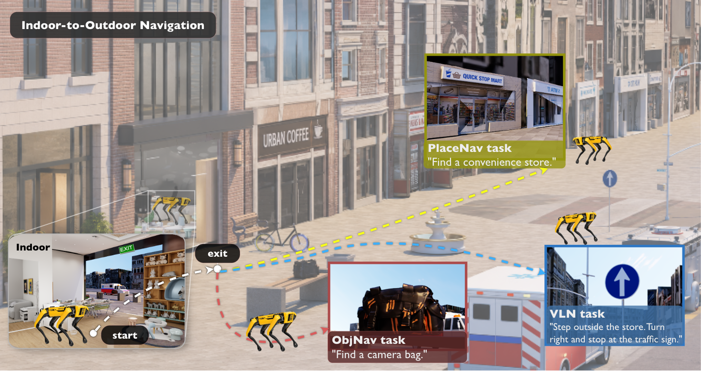

# NavVerse-Benchmark

**A physics-enabled benchmark for indoor-to-outdoor embodied navigation in
continuous robot simulation.**

[Project repository](https://github.com/UMich-CURLY/NavVerse-Benchmark) ·
[Dataset](https://huggingface.co/datasets/tccoin/navverse-benchmark)



NavVerse connects indoor, urban outdoor, and indoor-to-outdoor environments in
continuous physics simulation. It contains 100 indoor scenes, 50 outdoor
scenes, and 50 connected indoor-to-outdoor scenes, with 10,000 episodes across
Object Navigation (ObjNav), Vision-and-Language Navigation (VLN), and Place
Navigation (PlaceNav). Agents interact through executable robot interfaces,
enabling full navigation evaluation across changing environments and robot
embodiments.

## Unified Launcher

`navverse-run` is the public entry point for `setup`, `download`, `build`, and
`benchmark`. Run it without a task for the keyboard interface, or use an
explicit task for scripts and automation:

```bash
python -m navverse.launcher.cli setup --env-name navverse
navverse-run benchmark --preset benchmark_smoke --dry-run
navverse-run --list-tasks
navverse-run --list-presets
```

See [the launcher guide](docs/launcher.md) for the full CLI and
[the baseline overview](baselines/README.md) for individual methods.

## 🛠 Installation & Data Setup

You can set up NavVerse natively with Conda or build the Docker image.

### Option 1: Native Setup (Conda)

The setup task creates a conda environment and installs NavVerse, PyTorch,
Isaac Lab/Sim, and the runtime data tooling:

```bash
python -m navverse.launcher.cli setup --env-name navverse
```

### Dataset Release

To install the runnable scene and episode release into
`navverse_data`:

```bash
navverse-run download
```

The downloader retrieves `navverse_v1_july23.tar.gz`, its SHA-256 file, and the
`episodes/` data from
[`tccoin/navverse-benchmark`](https://huggingface.co/datasets/tccoin/navverse-benchmark),
verifies the archive, extracts it, checks all scene and navmesh families, and
updates `SCENE_FOLDER` and `EPISODE_FOLDER` in `.env`. A custom destination can be selected
with `--output-dir`; pass the same directory later through `--scene_folder` or
set both paths in `.env`. Use `--skip-episodes` only when installing scene
assets without benchmark tasks.

The installed layout is:

```text
navverse_data/
├── vc_plus/
├── grscenes_commercial/
├── navmesh/
├── episodes/
└── nvidia -> vc_plus/nvidia
```

Keep enough free space for both the downloaded archive and extracted data
during installation. To download the raw repository snapshot instead, use
`navverse-run download --raw`; raw mode intentionally skips
packaged `navverse_v1_*` scene releases unless explicit `--include` patterns
are provided.

### Option 2: Docker Setup

The Docker recipe installs system dependencies and Isaac Sim. Install the
NVIDIA Container Toolkit to enable GPU acceleration.

1. Build the warmed image:

```bash
navverse-run build --image navverse-release:local
```

2. Launch with Docker Compose

Set `NAVVERSE_DATA_DIR` to the installed dataset directory. Compose mounts it read-only and writes results to `NAVVERSE_OUTPUT_DIR` (default `dump`). Start the locally built image:

```
docker compose -f docker/docker-compose.yml run test
```

## 🚀 Benchmark Evaluation

Benchmark configurations live under `baselines/presets/`. Explicit launcher
arguments override preset values; other arguments are forwarded to
`baselines/eval_navverse.py`.

```bash
navverse-run benchmark --preset benchmark_uninavid_450
navverse-run benchmark --preset benchmark_smoke --dry-run
```

Available agent names are registered in `navverse/launcher/registry.py`. Full
episode JSON files are installed under `navverse_data/episodes/`;
the versioned split manifests remain under `episodes/`. See
[the launcher guide](docs/launcher.md) for direct evaluator, Docker, and
SageMaker examples.

### Episode Task Generation

To start the automated task generation process for scenes:

```bash
python scripts/navverse_task_generation.py --test_scene_id <scene_id>
```

## 📁 Repository Structure

- `navverse/`: Core package containing the simulator and environment wrappers.
- `navverse_tools/`: Scene editing and task generation tools for NavVerse.
- `baselines/`: Reference implementations and distributed evaluation scripts.
- `baselines/presets/`: YAML benchmark launch configurations.
- `scripts/`: Utility scripts for task generation, evaluation, and setup.
- `episodes/`: Versioned split manifests; full episode JSON files are distributed with the dataset.

## 🔧 NavVerse Tools

Scene processing, task generation, dataset utilities, terrain evaluation,
and analysis tools are documented in the
[NavVerse tools README](navverse_tools/README.md). The tools also include an
[experimental real-world navigation server](navverse_tools/real_world_exp_server/README.md)
for browser and iOS-based robot experiments.

## License

NavVerse source code is licensed under [Apache-2.0](LICENSE). Other components
have separate terms:

- Isaac Lab-derived training code: BSD-3-Clause.
- Included TidyBot robot meshes: upstream MIT terms.
- Included Spot locomotion checkpoint: a project-provided model weight, separate from the source-code license.
- Scene datasets, Isaac Sim, and external baseline dependencies: obtained separately under their respective terms.

See [third-party notices](licenses/THIRD_PARTY_NOTICES.md) for sources and
license links.
